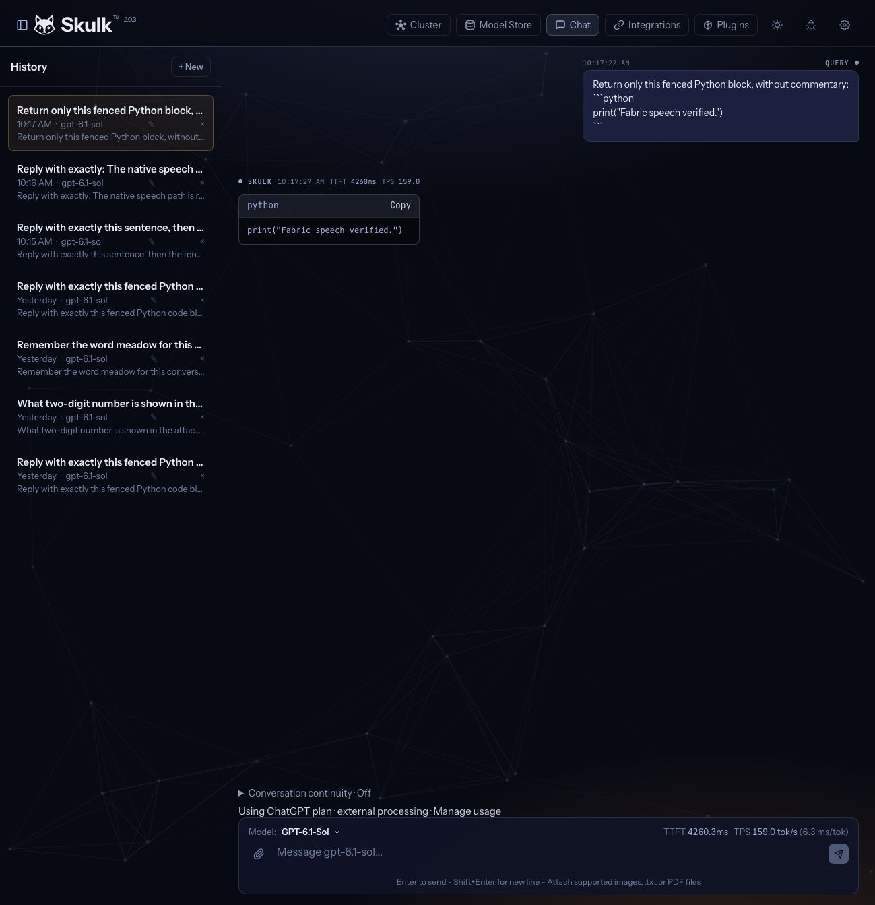

After [setup](getting-started.md), choose an Integrator model in Skulk Chat. Text and code use the normal conversation interface; the integration's processing and model permissions still apply.

*This is an existing completed test conversation. Code is formatted for reading and copying; rendering a code block does not run it.*

## Choose the model for the conversation

Open the model picker and select the enabled capability model you want. The Integrator's diagnostic default does not select it for you. Read the ChatGPT-plan/external-processing notice before sending private material.

## Add images or documents

Use **Attach file** and select an attachment supported by the selected model and gateway. The integration accepts bounded inline PNG, JPEG and WebP images, UTF-8 `.txt` documents and PDF files. PDF input needs a model with text and image support and enabled image permission.

The selected content is sent to OpenAI with the request. It is not a local-only document analysis path. This version does not follow remote file/image URLs, upload through OpenAI's Files API, accept arbitrary local paths in JSON, or support audio/video attachments through the Integrator.

For the streamed chat path, the complete encoded request is bounded to 16 MiB. It allows up to eight documents, each at most 8 MiB decoded, subject to that aggregate bound and base64 overhead. These are transport limits, not the model's context size. Reduce an attachment if the request is too large.

## Use tools

The Integrator can pass function tools supplied by an application and return the model's calls. That application must execute the function and return its result under the same call ID before continuing the tool cycle.

Enabling **Function tools** does not install tools in Chat, grant filesystem/shell access or enable OpenAI's hosted Code Interpreter. An external application such as AnythingLLM must supply its own supported tool definitions and handle the returned calls.

## Speak a response

Speech comes from a **mounted Skulk TTS model**, independently of the OpenAI model producing text.

1. Mount a compatible speech model in Skulk and wait until it is ready.
2. In Chat, choose it in **TTS** and select an available voice.
3. Use **Speak message** on a completed assistant response, or enable **Auto** to speak new responses.
4. Use **Stop speech** to stop playback.

TTS controls appear when suitable mounted capacity is reachable. The Integrator itself does not mount a speech model or expose OpenAI's audio endpoints. See Skulk's [speech API reference](https://docs.foxlight.ai/skulk/next/api-guide/#openai-audio-speech-api) and the Integrator's [tested scope](compatibility.md).

## Continue longer conversations

Ordinary requests carry public conversation history. Optional protected continuation preserves encrypted provider working state, and a qualified compaction profile can reduce the provider context used on later turns. These need [additional configuration](context.md); connecting the account alone does not enable them.
