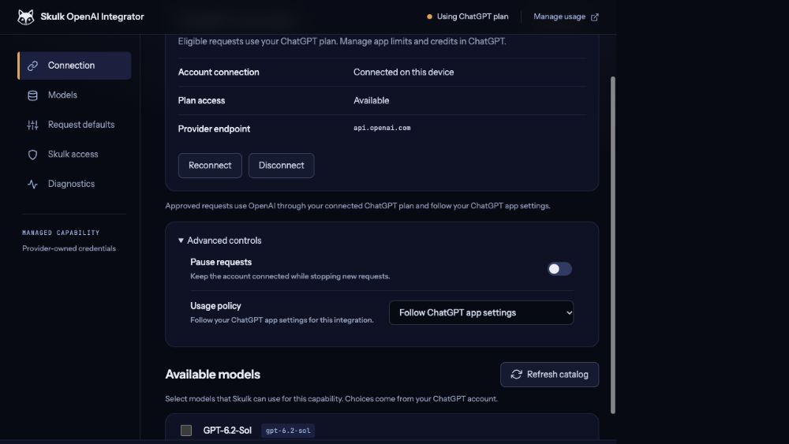

Open the installed Integrator's management page and choose **Connection**. This page controls the ChatGPT connection and whether new requests may use it.

*Advanced controls contains Pause requests and Usage policy. These are separate from OpenAI's own app settings.*

## Usage policy

Keep **Follow ChatGPT app settings** selected. Open **Manage usage** to review this app in ChatGPT. Requests use the connected account's plan and any credit settings enabled there; the Integrator does not promise that a request uses included allowance only.

**Included usage only** is unavailable in this version. The Integrator cannot reliably establish that exclusion for each request. A local request or output ceiling is also not a spending guarantee.

OpenAI's [ChatGPT plan-usage guidance](https://developers.openai.com/siwc/token-sharing-open-source) describes the provider side of this connection.

## Pause new requests

1. Expand **Advanced controls**.
2. Turn on **Pause requests**.
3. Save settings.

The account remains connected. Turn the switch off and save to resume. A fresh installation enables inference; pausing is an explicit operator choice. A saved pause survives an update.

## Refresh the model catalog

The catalog loads automatically after consent and refreshes as needed. Choose **Refresh catalog** when checking a changed account or model selection. Refreshing discovers choices; it does not enable newly listed models for you.

The account's model list can change. Availability in a catalog does not establish remaining allowance or every model feature.

## Reconnect

Use **Reconnect** when the interface asks you to sign in again. Complete any requested OpenAI consent and wait for the connected state. Reconnecting or changing the account can require renewed model and gateway approvals. Check **Models** and **Skulk access** afterward.

## Disconnect

Choose **Disconnect** to stop new account admission and remove local session tokens. The capability also attempts provider-side session revocation. If revocation cannot be confirmed, use ChatGPT's connected-app settings to remove the app there too.

A request that had already reached OpenAI may have executed before disconnection. Disconnecting or cancelling does not prove the upstream work was undone. See [interrupted requests](troubleshooting.md#a-request-was-interrupted).
