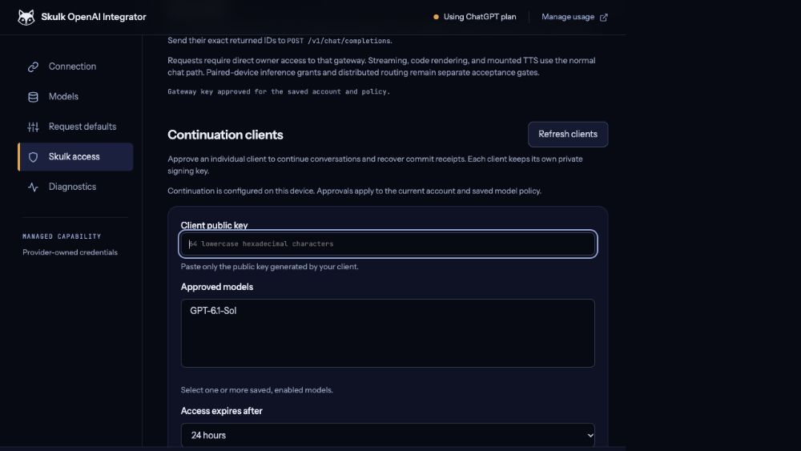

A long conversation has two kinds of state: the messages your application shows, and the working context sent to the provider. Compaction reduces the latter. It does not delete the visible conversation or increase the model's intrinsic context window.

## Choose the level you need

| Mode | What happens | Extra setup |
| --- | --- | --- |
| Ordinary Chat/API | Each request supplies the required public history. | Normal account, gateway and caller approvals. |
| Protected continuation | The capability keeps encrypted provider working state and issues authenticated commit receipts. | Explicit storage policy and an approved client public key. |
| Automatic compaction | OpenAI compresses provider context when a configured threshold is crossed; the capability carries its encrypted continuation items forward. | Protected continuation plus a qualified model profile. |

OpenAI performs the actual compression. The capability manages the returned encrypted state and its lifecycle. Skulk carries the authenticated calls and receipts. See OpenAI's [compaction guide](https://developers.openai.com/api/docs/guides/compaction) for the provider mechanism.

## Configure protected storage

Open the installed capability's node configuration in **Plugins**. Preserve the existing `application.state_directory` and other values. Add an `application.continuation` object such as:

```json
{
  "storage": {
    "retention_seconds": 3600,
    "maximum_records": 16,
    "maximum_storage_bytes": 8388608
  },
  "profiles": []
}
```

The example is the value of `application.continuation`, not the whole node configuration. It retains records for up to one hour, bounds their count and total encrypted storage, and enables **no automatic compaction profiles**. Choose limits appropriate to your use; these settings are not model-token or usage allowances.

Saving node configuration can restart the child. Wait for healthy status before continuing.

## Approve a continuation client

A compatible client generates its signing key locally. In **Skulk access → Continuation clients**, paste **only its public key**, select enabled models and an expiry, then choose **Approve public key**. Return the displayed public enrollment to that client. The private key stays with the client.



*This screenshot shows an installation with storage already configured. An ordinary API key and a continuation signing key serve different purposes.*

For a compatible dashboard, use Chat's **Conversation continuity** controls to perform its supported enrollment/setup. If those controls or the continuation contract are absent, keep using ordinary Chat and check host compatibility. External clients need the exact signing/enrollment protocol; generic OpenAI-compatible history alone does not implement protected continuation. The [client enrollment reference](https://github.com/Foxlight-Foundation/skulk-openai/blob/eaf486e601aa692f1124b56e06947391040fc054/docs/client-enrollment.md) covers the CLI and signed request format.

## Enable a qualified compaction profile

Native 0.6.3 qualification covers **GPT-6-Luna and GPT-6.1-Sol** on the recorded serving path. For an enabled Sol model, this is the qualified profile shape to add to `application.continuation.profiles`:

```json
{
  "model": "gpt-6.1-sol",
  "context_tokens": 1050000,
  "reserved_output_tokens": 128000,
  "threshold": 787500,
  "terminal_output": "empty_snapshot"
}
```

Keep the storage policy. Use a separate profile with `model: "gpt-6-luna"` for the qualified Luna path. Do not infer equivalent context facts or the terminal dialect for another model just because it appears in the catalog. Model/path changes require renewed qualification.

The reserved output value leaves context headroom; it is **not an output cap**. The threshold triggers context management. Changing a profile changes the protected context policy, so start a new context transition through the client rather than silently reusing an old checkpoint.

## Recover an uncertain turn

A compatible client can query a signed receipt to learn whether the exact turn committed. Receipt lookup performs no new generation and does not recover the response text. It cannot turn an interrupted attempt into a committed result.

Do not automatically replay generation after a lost connection. A request may have reached OpenAI even if the client did not receive its terminal result. Expired/revoked clients, account changes and profile changes can also make an old checkpoint unusable.
