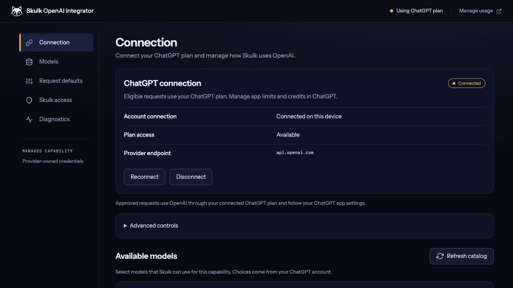
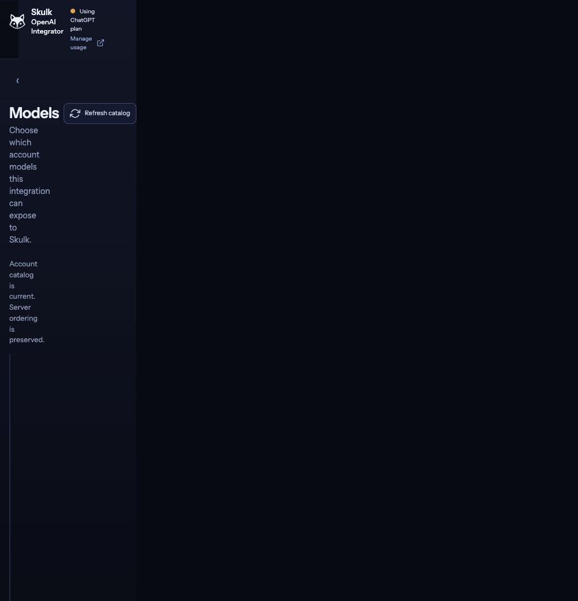

Follow these steps on the device hosting the Integrator. You need a [compatible Skulk build](compatibility.md), a signed Integrator release for your platform, and a ChatGPT account eligible for OpenAI's plan-usage connection.

You do not need to create an OpenAI API key for this connection. OpenAI determines account eligibility and presents any required sign-in and plan-consent steps.

## 1 Install from the Store

1. Open **Plugins** in Skulk. If it offers local manager setup, complete that setup and wait for its ready confirmation, then open **Browse**.
2. Find **Skulk OpenAI Integrator** and review the release and permissions.
3. Install the signed native release for your platform.
4. Open its configuration. Choose a **new, private state directory** belonging to your OS user. Keep that directory for future updates.

If the configuration editor asks for JSON, this is a minimal application configuration:

```json
{
  "application": {
    "state_directory": "~/.local/state/skulk-openai-native",
    "inference_enabled": true
  }
}
```

Use a new or empty directory. Do not point a new installation at another application's account state. The host checks the path and initializes the installed application there.

**You should see:** a healthy installed capability. In its **Browse** card, choose **Open → management**; the capability’s topology action also opens its management page. **Configure** edits the installed node’s configuration, including its state directory; it is a different screen. A fresh installation starts disconnected.

## 2 Connect your ChatGPT account

1. On **Connection**, choose **Continue with ChatGPT**.
2. Complete OpenAI's sign-in and plan-consent flow in the page it opens.
3. Return to the Integrator. Wait for **Connected** and **Plan access: Available**.

[](images/connection.jpg)

*This is the successful connected state. A fresh installation offers Continue with ChatGPT in place of Reconnect and Disconnect.*

Models load automatically after consent. **Follow ChatGPT app settings** is the normal usage policy. A diagnostic request is optional; it sends a real prompt to OpenAI.

## 3 Choose models

1. Open **Models**.
2. Enable the models you want Skulk to offer.
3. Choose a **Default model** for the Integrator's diagnostics.
4. Choose **Save settings** and wait for the saved confirmation.

[](images/models.jpg)

*Enabled models can be offered to authorized Skulk callers. The Default model here selects the diagnostic model; choose your conversation's model in Chat.*

Start with one model if you are unsure. You can change the selection later. [Settings](settings.md) explains request defaults and optional local ceilings.

If your application supplies function tools, enable **Function tools** in **Request defaults** and save. Fresh installations leave that permission off; the screenshot of request defaults shows an already configured example.

## 4 Approve Skulk's gateway

An account connection lets the capability contact OpenAI. It does not authorize Skulk to use the account yet.

1. In the Integrator, open **Skulk access**.
2. Under **Gateway delegation**, enter the local Skulk API port. The usual port is **52415**; use the actual port of your compatible host if different.
3. Choose **Find gateway**. The Integrator finds that gateway's public signing key.
4. Choose **Save settings** to approve it for the current account, enabled models and saved policy.

**You should see:** a message that the gateway key is approved for the saved account and policy. This uses a public key; it does not give Skulk the account's OAuth tokens.

## 5 Authorize this dashboard

The gateway also checks who is asking to use the capability.

1. Return to Skulk and open **Settings → Inference access**.
2. Enable approved access.
3. Choose **This dashboard (direct owner)**.
4. Select the installed Integrator capabilities you want the dashboard to use. Review the external-processing disclosure.
5. Choose **Save inference access** and wait for confirmation.

These are separate approvals:

| Approval | Meaning |
| --- | --- |
| ChatGPT connection | This capability may use the connected account. |
| Integrator gateway approval | This Skulk gateway may submit requests under the integration's policy. |
| Skulk caller approval | This dashboard or API client may use the selected installed capabilities. |

Do not create an API client key just to use the local dashboard. External applications get their own keys in the [API setup](api.md).

## 6 Have a first conversation

1. Open **Chat** in Skulk.
2. Open the model picker and choose an enabled Integrator model.
3. Send a short message, such as “Explain what a compute fabric is in two sentences.”

**You should see:** a streamed assistant response and the ChatGPT-plan/external-processing notice. Ordinary Chat does not require configuring protected continuation or compaction first.

If the model is absent, follow [Models are missing from Chat](troubleshooting.md#models-are-missing-from-chat). A successful diagnostic alone does not prove the gateway and caller approvals are complete.
