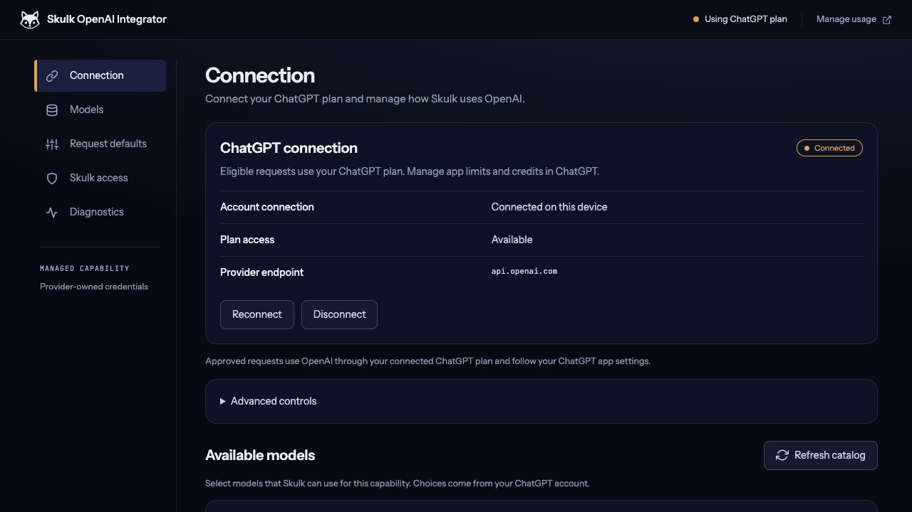

Use OpenAI models in Skulk Chat and applications connected to Skulk's unified API. The Integrator connects your ChatGPT account, exposes the models you choose, and keeps provider credentials inside the capability.

**Start here:** [Install and connect](getting-started.md). Already connected? [Choose models and defaults](settings.md), [use Chat](chat.md), or [connect another application](api.md).

> **Check your release channel.** The original native preview is 0.6.3; the SDK1 preview is 0.7.1. They require their matching experimental Skulk hosts. This is not a stable Skulk release. Check [compatibility](compatibility.md) and the Store listing before installing; a version number alone is not enough.

*Connection is the place to manage your ChatGPT account. Your model list may differ from this example.*

Select a screenshot to open it at full size.

## How the pieces fit

| Piece | What it does |
| --- | --- |
| Skulk OpenAI Integrator | Connects the account, owns provider credentials, and applies integration settings. |
| Skulk | Discovers approved models and carries Chat and API requests through its generic capability host. |
| OpenAI | Runs the selected model under your connected account's access and usage settings. |
| Your application | Supplies the conversation and any tools. It executes tool calls under its own permissions. |

The Integrator is installed as a managed capability. You do not paste your OpenAI credentials into Chat or another application. Those applications authenticate to Skulk.

## What you can do

Use text and code responses, supported image/text/PDF attachments, streaming, client function tools and structured output. You can also use a mounted Skulk speech model to read responses aloud. Protected continuation and automatic compaction are optional; [context management](context.md) explains the extra setup.

The [feature table](compatibility.md#features-in-this-preview) distinguishes the Integrator's implemented features from other OpenAI services.

## Find the right guide

- [Install and connect](getting-started.md): from the Store to a first conversation.
- [Manage the connection](connection.md): usage policy, pausing, reconnecting and disconnecting.
- [Models and request defaults](settings.md): every integration setting and what it changes.
- [Chat and attachments](chat.md): images, files, code, tools and speech.
- [Use the unified API](api.md): client keys, model discovery and request examples.
- [Context and compaction](context.md): ordinary history, encrypted checkpoints and optional profiles.
- [Privacy and access](security.md): where data goes and what each permission grants.
- [Troubleshooting](troubleshooting.md): connection, discovery, permission and interrupted-request problems.
- [Compatibility](compatibility.md) and [release notes](release-notes.md): requirements, tested scope and changes.

For developers building capabilities, use [Foxlight Developers](https://developers.foxlight.ai/build/sdk/native-preview/). This manual covers operating the installed Integrator.
