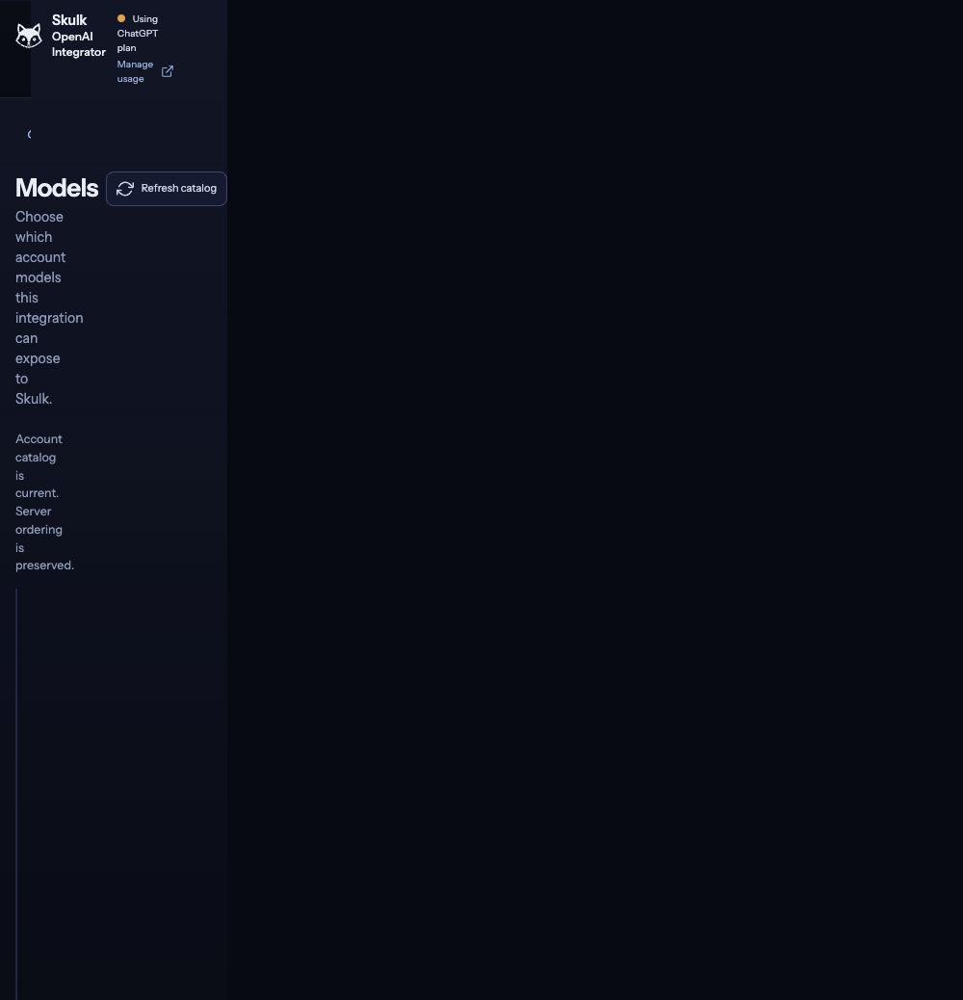
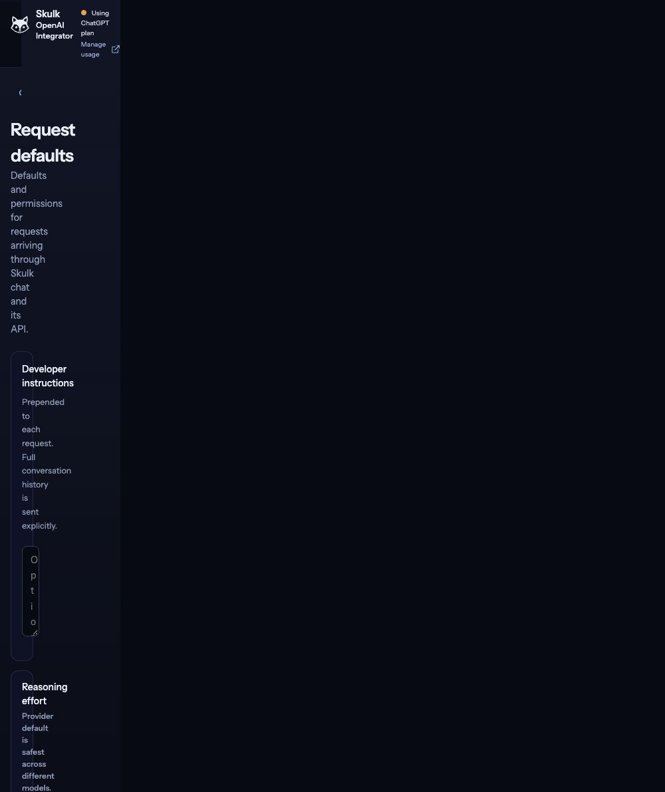

Use **Models** to choose which account models Skulk may offer. Use **Request defaults** for the baseline applied to incoming Chat and API requests. Save after changing either page.

## Model selection

Enable only the models you want available through this integration. The **Default model** dropdown is for the Integrator's diagnostics. Each Chat conversation or API request still chooses a model; it does not automatically use that diagnostic default.

Disabling a model withdraws it from this integration's available choices. Account changes require reviewing the saved selection again. Catalog names and ordering come from the connected account, so your page may differ from the screenshot.

## Request defaults

*The switches control this integration. Their off state for a ceiling means no local ceiling; provider, model and transport limits still apply.*

| Setting | What it changes | Starting point |
| --- | --- | --- |
| Developer instructions | A shared instruction baseline prepended to requests through this integration. Application/conversation messages are supplied separately. | Leave blank unless all callers need the same instruction. |
| Reasoning effort | Supplies a reasoning default when the request omits it. Supported values vary by model. | Provider default. An unsupported choice can be rejected; listing a level does not establish model support. |
| Response verbosity | Supplies a verbosity default when the request omits it. | Provider default; choose low, medium or high when appropriate to the model. |
| Function tools | Permits forwarding function definitions and returning model tool calls. | Enabled for fresh installations. The calling application executes the tools. |
| Image input | Permits supported inline image input; PDF support also depends on image permission. | Enabled for fresh installations. |
| Limit output length | Opts into a local **character** ceiling, including text, reasoning summaries and tool arguments. | Off. This is not a token limit, a context window or a billing cap. |
| Limit request rate | Opts into a shared local request-attempt ceiling per hour. | Off. This is separate from OpenAI's allowance. |

An explicit request value takes precedence over the corresponding reasoning or verbosity default. Integration permissions still apply: a caller cannot turn a denied feature back on by adding a request field.

## Instructions and output formats

A baseline such as “Use concise, plain English” can be appropriate across applications. A task-specific instruction such as “Return the invoice as JSON” belongs to that application or request. Avoid forcing every conversation into a task-specific format through the global instruction box.

For structured output, an API caller supplies its response format/schema per request. The Integrator validates supported forms before forwarding them. A model returning JSON does not execute a program or call a tool by itself.

## Reasoning summaries

Reasoning effort influences how the model approaches the task. A requested reasoning summary is separate displayable output; it is not raw internal reasoning. The current dashboard settings do not provide a dedicated summary control. Applications can request supported summary behavior through the compatible Chat/API contract.

## What these controls cannot enable

Changing a setting cannot add an unimplemented hosted tool or an unsupported model feature. This preview does not expose temperature or an upstream output-token cap. [Compatibility](compatibility.md#features-in-this-preview) lists the supported integration surfaces.
