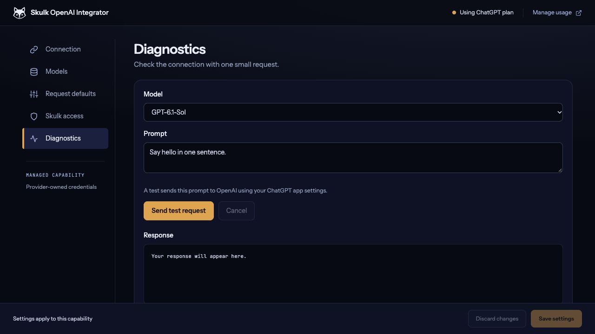

Start at the step that failed. **Connected**, **model enabled**, **gateway approved** and **caller authorized** describe different conditions.

| What you see | What to check |
| --- | --- |
| No compatible Integrator release | Check platform and the exact host cohort in [Compatibility](compatibility.md). Stable Skulk is not yet the native preview host. |
| Sign-in finished but plan access is unavailable | Complete the provider's plan-consent flow; use Reconnect when requested. Identity sign-in alone does not grant model usage. |
| Old “continue” message remains | Return to Connection and allow the page to refresh. Reload a stale page; use the current Open management action from Plugins Browse or the topology after a service restart. |
| Diagnostics is blocked | Check Pause requests is off, an enabled default model is saved, and Usage policy is Follow ChatGPT app settings. |
| No models or stale catalog | Wait for automatic refresh or choose Refresh catalog. Check connection/plan access and saved model selection. |
| Chat/API says access denied | Check gateway delegation and the exact authenticated caller's permissions in Skulk Inference access. |
| An API key works for discovery but generation fails | Model discovery does not grant generation. Approve the client's needed installed inference capabilities and review processing policy. |
| An attachment is rejected | Check model support, image permission for images/PDF, supported file type and aggregate request size. |
| No speech controls | Mount a compatible Skulk TTS model and wait for reachable ready capacity. |
| Continuation is unavailable | Check configured storage, client enrollment/expiry, exact host contract and model profile. Ordinary Chat can still work without it. |

## Models are missing from Chat

1. In **Connection**, confirm Connected and plan access available.
2. In **Models**, enable the intended model and save.
3. In **Skulk access**, confirm the current gateway is approved.
4. In Skulk **Inference access**, choose the actual caller and approve the selected installed capability implementation.
5. Check the model picker or `/v1/models` again.

After an application update, review the new signed implementation. A stale permission for the previous runtime does not authorize the replacement.

## Use diagnostics deliberately

*This screen is ready for an optional test; the screenshot does not show a new request or a claimed result.*

Select an enabled model and a small non-sensitive prompt, then choose **Send test request** only when you want to make that real provider request. It uses the connected ChatGPT app settings. A successful result proves this capability/account path; it does not by itself prove Core caller setup or every model feature.

## A request was interrupted

An interrupted stream can have an uncertain upstream outcome. Keep the original error/attempt record. A compatible protected-continuation client should query the receipt before deciding how to proceed. Do not assume that pressing retry is free of duplicate execution.

A fresh, deliberate diagnostic is different from automatically resubmitting the interrupted request. Avoid repeatedly retrying a large failing conversation without understanding the error and current access/usage state.

## An update or restart changed access

Keep the existing private state directory and use the normal Store update. Open the current management action from Plugins Browse or the topology; a previous temporary UI port can stop responding after restart. Confirm account connection, saved models, gateway approval and current caller permissions. Do not delete state or edit security databases to clear an error.

## Startup after an unclean shutdown

Preserve the private state directory and its SQLite sidecars. Do not delete a
rollback journal to clear a startup error: it may be needed to recover the last
committed state. Stop the capability before offline inspection or backup.

The SDK1 0.7.1 preview performs SQLite's normal recovery under stable serving
fences before checking the original store identity. This passes on the exact
production-signed installed package with account and encrypted checkpoint state. The issued
0.6.3 preview can remain at Starting when this recovery is required; preserve
its files for offline assistance. Corrupt databases, unsafe paths and partial
state transfers remain separate failures; this recovery does not reset them.
